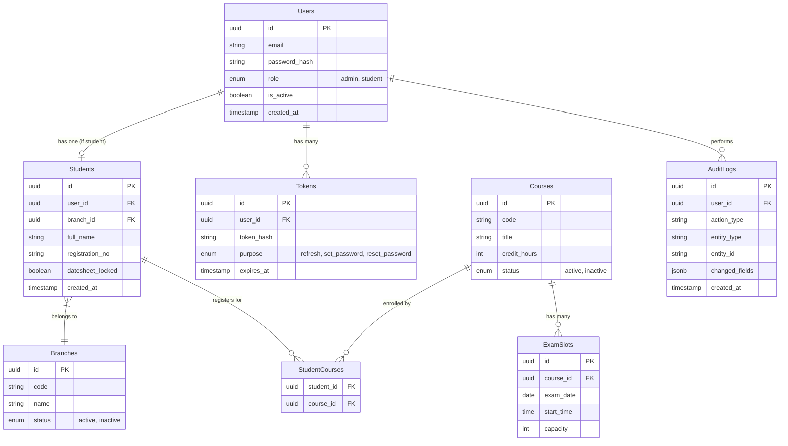

# ExamSlot

A full-stack self-service exam date sheet system for a multi-branch virtual university.

## Architecture

* **Backend**: FastAPI, SQLAlchemy 2.0 (Sync with psycopg), Alembic, Pydantic v2
* **Frontend**: React 18, Vite, Tailwind CSS, TanStack Query, React Hook Form, Zod
* **Database**: PostgreSQL (Supabase Connection Pooler)

## ERD (Mermaid)

## Setup Instructions

### Prerequisites
- Python 3.11+
- Node.js 18+
- PostgreSQL database (Supabase recommended)

### Backend Setup
1. `cd backend`
2. Create virtual environment: `python -m venv venv`
3. Activate venv: `.\venv\Scripts\activate` (Windows) or `source venv/bin/activate` (Mac/Linux)
4. Install dependencies: `pip install -r requirements.txt`
5. Configure `.env` from `.env.example`
6. Run migrations: `alembic upgrade head`
7. Seed the database: `python seed.py`
8. Start the server: `fastapi dev app/main.py`

### Frontend Setup
1. `cd frontend`
2. Install dependencies: `npm install`
3. Start the dev server: `npm run dev`

### Credentials
- **Admin**: admin@examslot.test / Admin123!
- **Student**: student1@examslot.test / Student123!

## Implementation Notes
- Security: CORS, Rate Limiting (Note: In-memory store used for rate limiting. In a multi-worker production setup, Redis should be used instead. **Proxy Trust:** The rate limiter uses `X-Forwarded-For`. This is only safe if you set `TRUST_PROXY=true` in your `.env` and your server sits behind a proxy (like NGINX or AWS ALB) that guarantees this header is set. If not behind a proxy, leave it `false` to prevent IP spoofing.), HttpOnly cookies for refresh tokens.
- UI: Fully responsive Tailwind CSS, custom Modal and ConfirmDialog components.
- Audit: JSON diffs recorded for all admin actions.
- Testing: Tests default to an in-memory SQLite database for speed. To test against a real PostgreSQL instance (e.g., Supabase), provide `TEST_DATABASE_URL` with a connection string ending in `/test` or set `ALLOW_DESTRUCTIVE_TESTS=true`. Be aware that running the test suite on a remote Postgres instance takes ~60 seconds, because the database schema is dropped and recreated for each individual test to guarantee strict isolation.
- Timezones: Slot dates and times are stored as `TIMESTAMP WITHOUT TIME ZONE`. They implicitly represent local Asia/Karachi wall-clock times to ensure immutable indexes for GIST exclusion constraints.

## Concurrency Tests Status

| Group | Feature | Status |
|-------|---------|--------|
| 1 | 4-to-6 rule (API 422, DB trigger, parallel inserts) | ✅ Passing on Postgres |
| 2 | Branch selection (inactive 422, second-select 409, parallel race) | ✅ Passing on Postgres |
| 3 | Capacity row lock (1-seat slot, two parallel students) | 📋 Planned |
| 4 | Overlapping slots & GIST exclusion | 📋 Planned |
| 5 | Null end-time conflict | 📋 Planned |
| 6 | Submit lock & double-click race | 📋 Planned |
| 7 | Admin edits after lock, slot delete with active selection | 📋 Planned |

Groups 3–7 require the Exam Slots domain (Part 2/3 of the spec) which is not yet implemented.

## Demo Scope

The demo covers the implemented and verified flows:

1. **Admin login** → manage branches, courses, students
2. **Student login** → select branch (one-time, conflict-blocked), submit date sheet (4–6 courses enforced), view/print date sheet
3. **Conflict blocking** is enforced at the database level via a deferred constraint trigger and a `SELECT … FOR UPDATE` row lock, so duplicate submissions are rejected even under concurrent load

Features described but not yet demoed (planned for post-hackathon):
- Exam slot scheduling (GIST exclusion, capacity limits)
- Student unlock/change requests
- Email notifications via Resend

