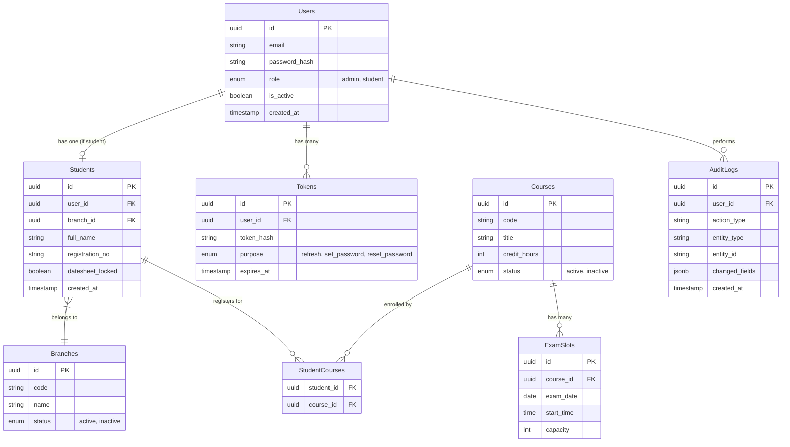

# ExamSlot

A full-stack self-service exam date sheet system for a multi-branch virtual university.

## Architecture

* **Backend**: FastAPI, SQLAlchemy 2.0 (Sync with psycopg), Alembic, Pydantic v2
* **Frontend**: React 18, Vite, Tailwind CSS, TanStack Query, React Hook Form, Zod
* **Database**: PostgreSQL (Supabase Connection Pooler)

## ERD (Mermaid)

## Setup Instructions

### Prerequisites
- Python 3.11+
- Node.js 18+
- PostgreSQL database (Supabase recommended)

### Backend Setup
1. `cd backend`
2. Create virtual environment: `python -m venv venv`
3. Activate venv: `.\venv\Scripts\activate` (Windows) or `source venv/bin/activate` (Mac/Linux)
4. Install dependencies: `pip install -r requirements.txt`
5. Configure `.env` from `.env.example`
6. Run migrations: `alembic upgrade head`
7. Seed the database: `python seed.py`
8. Start the server: `fastapi dev app/main.py`

### Frontend Setup
1. `cd frontend`
2. Install dependencies: `npm install`
3. Start the dev server: `npm run dev`

### Credentials
- **Admin**: admin@examslot.test / Admin123!
- **Student**: student1@examslot.test / Student123!

## Implementation Notes
- Security: CORS, Rate Limiting, HttpOnly cookies for refresh tokens.
- UI: Fully responsive Tailwind CSS, custom Modal and ConfirmDialog components.
- Audit: JSON diffs recorded for all admin actions.
